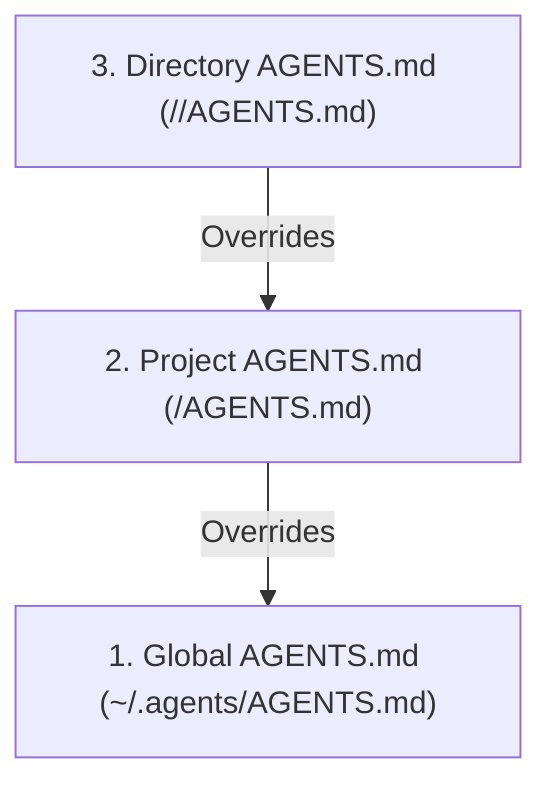

# AGENTS.md Authoring Skill

Guides the creation, structuring, and maintenance of `AGENTS.md` instruction files at both the project root and scoped directory levels.

`AGENTS.md` serves as the single source of truth for AI coding assistants working in a repository, defining project context, architecture, operational principles, quality standards, and actionable shell commands.

---

## When to Use This Skill

Activate this skill when:
- Bootstrapping a new repository's `AGENTS.md` (e.g. called during repository initialization via [`repository-setup`](../repository-setup/SKILL.md)).
- Auditing, restructuring, or enriching an existing repository's agent instructions.
- Establishing directory-level `AGENTS.md` files to customize instructions for specific packages in a monorepo or Cargo workspace.
- The project's tech stack, directory structure, or development commands have evolved and instructions need synchronization.

---

## Instruction Precedence & Hierarchy

AI agents operating in personal and team repositories follow an ordered hierarchy:



- **Priority**: From **3 to 1** (Directory AGENTS.md overrides Project AGENTS.md, which in turn overrides Global AGENTS.md).
- **Project AGENTS.md**: Located at the repository root; defines project-wide mission, architecture, general principles, quality standards, and commands.
- **Directory AGENTS.md**: Located in a specific subfolder (e.g., `packages/web/AGENTS.md`, `crates/cli/AGENTS.md`); overrides or extends project guidelines for that specific subtree.

---

## Standard AGENTS.md Structure

Every project `AGENTS.md` must adhere to the following mandatory structure (see [assets/AGENTS-template.md](./assets/AGENTS-template.md)):

```markdown
# <Project Name> Agent Instructions

[Instruction Precedence Callout]

## Project Information
[Name, purpose, tech stack, dependencies, runtime target]

## Project Structure
[Annotated directory tree and module placement conventions]

## General Principles
[Working principles, scope boundaries, autonomous skill triggers]

## Code Quality Requirements
[Type safety, error handling, testing, commenting, markdownlint]

## Commands
[Runnable build, test, lint, format, run, and CI verification commands]
```

### Section Breakdown

| Section | Mandatory Content |
| :--- | :--- |
| **Title & Precedence** | `# <Project Name> Agent Instructions` followed by a blockquote outlining the 3-level hierarchy (Directory -> Project -> Global). |
| **Project Information** | Crisp 1-2 sentence purpose statement, tech stack (language, compiler/runtime versions), primary frameworks, core libraries, and deployment target. |
| **Project Structure** | Annotated directory tree (using `mermaid` or `text` codeblock) illustrating key directories (`src/`, `tests/`, `docs/`, `devdocs/`, `config/`), module responsibilities, and placement conventions for new files. |
| **General Principles** | Non-negotiable operating rules: English communication, right to disagree, security/quality over speed, long-term maintainability, minimal footprint, and autonomous skill activation list. |
| **Code Quality Requirements** | Language-specific safety standards (strict types, newtypes, compile-time invariants), explicit error hierarchies, testing rules (AAA pattern, contract testing), and documentation/comment rules (e.g. Markdown doc comments `///`, no standard `//` line comments except for counterintuitive logic). |
| **Commands** | Copy-pasteable shell commands categorized under `Build & Run`, `Testing`, `Linting & Formatting`, and `Verification & CI Gates`. |

---

## Step-by-Step Authoring Workflow

### Step 1: Inspect Repository Context
Before generating or updating `AGENTS.md`, investigate the project's codebase:
- Check manifests: `Cargo.toml`, `package.json`, `pyproject.toml`, `go.mod`, etc.
- Inspect directory layout: identify source directories, test suites, documentation folders (`docs/`, `devdocs/`), and configuration files.
- Inspect CI/CD workflows: read `.github/workflows/` or `.gitlab-ci.yml` to uncover the exact linting, testing, and build commands used by automated gates.
- Check existing documentation: `README.md`, `CONTRIBUTING.md`, ADRs in `devdocs/decisions/`.

### Step 2: Synthesize Project Information
Identify:
- Exact project name and concise mission statement.
- Core language, compiler/runtime versions (e.g. Rust 1.75+ edition 2021).
- Frameworks and libraries (e.g. Tokio, Actix-web, Clap, Serde).
- Deployment targets (Docker, CLI binary, cloud service).

### Step 3: Map the Project Structure
Produce a clean, annotated directory tree showing:
- Where application logic lives.
- Separation between user documentation (`docs/`) and developer documentation (`devdocs/`).
- Where configuration and tests are stored.
- Explicit placement guidelines for where newly created components must go.

### Step 4: Codify General Principles
Incorporate core engineering principles:
- **English**: All communication, commit messages, and docs.
- **Right to disagree**: Agent must challenge poor designs, architectural debt, or security risks.
- **Security & quality over speed**: Never compromise robustness for expedient shortcuts.
- **Minimal footprint**: Avoid adding unrequested dependencies or modifying files outside task scope.
- **Autonomous skill activation**: List project-relevant skills (`docs-requirements`, `docs-adrs`, `docs-glossary`, `rust-development`, `docker`, etc.) that agents should automatically trigger.

### Step 5: Establish Code Quality Requirements
Codify concrete standards:
- **Type invariants**: Statically prevent invalid states; use newtypes for identifiers; avoid bare primitives.
- **Error handling**: Strongly typed errors (e.g. `thiserror`); no unstructured error strings.
- **Doc comments vs line comments**: Public APIs documented with `///` and `//!`. Forbid standard `//` comments on obvious code; restrict them solely to counterintuitive logic.
- **Testing**: Arrange -> Act -> Assert; test public contracts and failure modes.

### Step 6: Collect and Validate Commands
Provide verified, runnable commands:
- **Build**: debug and release builds.
- **Run**: local execution with sample arguments.
- **Test**: entire test suite, individual unit tests, and integration tests.
- **Format & Lint**: code formatters, static analyzers, and markdown linters (`markdownlint`).
- **Gate Check**: chained command simulating local CI validation.

### Step 7: Write the File
Write the content to `AGENTS.md` at the project root using the template in [assets/AGENTS-template.md](./assets/AGENTS-template.md).

---

## Directory-Level AGENTS.md (Scoped Overrides)

In monorepos or multi-package workspaces, individual subdirectories may require specialized rules (e.g., a frontend React package vs a backend Rust service).

When authoring a directory-level `AGENTS.md`:
1. Place it directly inside the target directory (e.g. `crates/cli/AGENTS.md` or `apps/web/AGENTS.md`).
2. Clearly state that it overrides or extends the parent `AGENTS.md` for files within its subtree.
3. Keep it tightly focused on package-specific technology, directory layout, and commands (e.g. `npm test` instead of `cargo test`).
