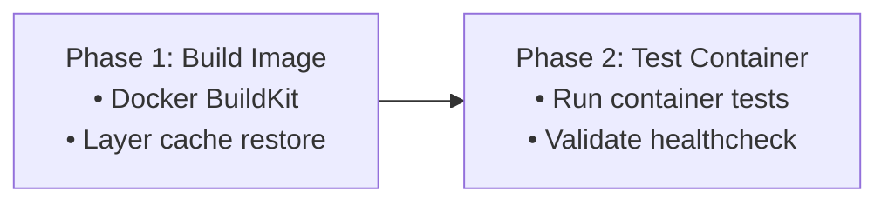

# CI/CD: Building and Testing Docker Containers

Integrating Docker builds into CI/CD ensures that images are reproducible and tested in identical runtime environments.

---

## 2-Phase Docker CI Pipeline



---

## GitHub Actions Example (`.github/workflows/docker-ci.yml`)

```yaml
name: Docker CI

on:
  push:
    branches: [main]
  pull_request:
    branches: [main]

jobs:
  build-and-test:
    name: Build & Test Container
    runs-on: ubuntu-latest
    steps:
      - name: Checkout Source Code
        uses: actions/checkout@v4

      - name: Set up Docker Buildx
        uses: docker/setup-buildx-action@v3

      # Phase 1: Build image with BuildKit cache
      - name: Build Docker Image
        uses: docker/build-push-action@v5
        with:
          context: .
          load: true
          tags: app:test
          cache-from: type=gha
          cache-to: type=gha,mode=max

      # Phase 2: Execute automated test suite inside container
      - name: Run Tests in Container
        run: |
          docker run --rm app:test pytest tests/ || npm test
```
