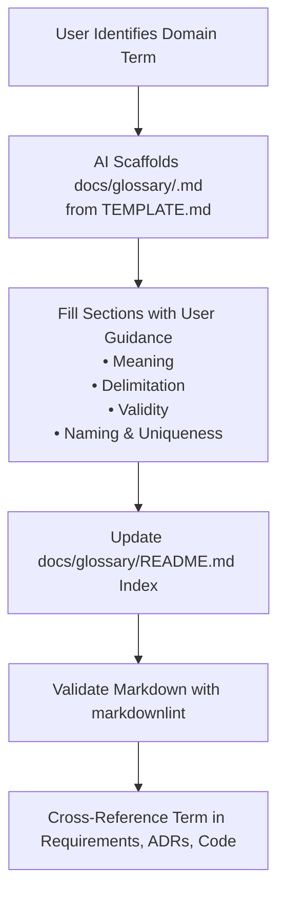

# Docs Glossary Skill

Maintains a standardized, objective project glossary in `docs/glossary/`. 

Projects often introduce proprietary terms, abbreviations, domain concepts, or ambiguous phrases. The glossary systemizes these terms into a single, authoritative source of truth that can be cross-referenced across requirements, Architecture Decision Records (ADRs), user manuals, and source code comments.

---

## Core Principles

1. **Human-Driven Definition (Strict Rule)**:
   - The AI coding agent **must never add new terms on its own initiative**.
   - Terms reflect human domain decisions. All new term additions must originate from explicit user requests or direct programmer guidance.
   - When asked to add or refine a term, the AI helps structure, formulate, and format the definition according to the template.
2. **Single Term per File**:
   - Each term is recorded in its own Markdown file within `docs/glossary/` using lowercase kebab-case (e.g., `docs/glossary/session-token.md`).
   - Keeps git diffs clean, avoids merge conflicts, and allows direct linking to specific terms.
3. **Markdown Quality**:
   - Every file must adhere to clean Markdown style and pass `markdownlint`.

---

## Glossary Structure

```text
docs/glossary/
├── README.md        # Index of terms and guidelines
├── TEMPLATE.md      # Canonical template for term definition
└── <term-slug>.md   # Dedicated markdown file for each defined term
```

### Term Lifecycle



---

## Step-by-Step Procedure

### 1. Initialize Glossary Directory (If Not Present)

If `docs/glossary/` does not exist:

1. Create the directory:
   ```bash
   mkdir -p docs/glossary
   ```
2. Copy `TEMPLATE.md` from [assets/TEMPLATE.md](./assets/TEMPLATE.md) into `docs/glossary/TEMPLATE.md`.
3. Create `docs/glossary/README.md` using [assets/README-template.md](./assets/README-template.md) to serve as the glossary index.

### 2. Add a New Term (Upon User Request)

When the user requests adding a term (e.g., *"Add 'Workspace Branch' to the glossary"*):

1. **Create the file**: `docs/glossary/<term-slug>.md` (e.g., `docs/glossary/workspace-branch.md`).
2. **Populate using the standard template**:
   - `# {{Term}}`: The formal name of the term.
   - `**Synonyms:**`: Alternative names, abbreviations, or legacy terms.
   - `## Meaning`: 1–2 crisp sentences defining what it is, its purpose, and its context.
   - `## Delimitation (Scope and Exclusions)`: Explicitly state what is *outside* the definition to prevent scope creep.
   - `## Validity`: When and where the term applies (e.g., system runtime, cloud deployment, compile-time).
   - `## Naming and Uniqueness`: How instances are identified (e.g., UUID, semantic key, URI).
   - `## Open Issues / Uncertainties`: Known edge cases or pending domain questions.
   - `## Related Terms (Cross-References)`: Markdown links to related terms in `docs/glossary/`.
3. **Register in `docs/glossary/README.md`**:
   Add a row to the table in `docs/glossary/README.md` with the term name, a brief one-line description, and a link to the term file.

---

## Term Template Reference

The canonical template located in [assets/TEMPLATE.md](./assets/TEMPLATE.md):

```markdown
# {{Term}}

**Synonyms:** {{List of synonyms}}

## Meaning

{{Explain the meaning of the term, in ideally one or two sentences. Include what it represents, its purpose, or how it is used in context.}}

## Delimitation (Scope and Exclusions)

{{Clarify where this term applies and where it does not. Describe boundaries or cases that are explicitly excluded.}}

## Validity

{{Describe temporal, spatial, or contextual validity — for example, when or where the term is applicable.}}

## Naming and Uniqueness

{{Explain how the term is identified unambiguously — e.g., by an ID, key, or other defining attributes.}}

## Open Issues / Uncertainties

{{List unresolved questions, unclear definitions, or aspects pending clarification.}}

## Related Terms (Cross-References)

{{List (and possibly link) related or similar terms, e.g., “User”, “Identifier”, “Session Token”.}}
```

---

## Linting & CI/CD Recommendation

Because glossary entries serve as long-term reference documentation, ensure consistent Markdown formatting:

1. **Local Linting**:
   ```bash
   npx markdownlint-cli "docs/glossary/**/*.md"
   ```
2. **CI/CD Integration**:
   Include markdown linting in the project's syntax-check workflow (e.g., `.github/workflows/lint.yml`):
   ```yaml
   - name: Lint Markdown Documentation
     run: npx markdownlint-cli "**/*.md" --ignore node_modules
   ```
