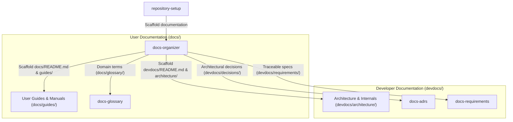

# Docs Organizer Skill

Scaffolds, structures, and organizes comprehensive documentation across two distinct scopes:
1. **User Documentation (`docs/`)**: Meant for end-users, operators, and consumers.
2. **Developer Documentation (`devdocs/`)**: Meant for engineers, contributors, and maintainers.

This skill serves as the central documentation architect. When setting up or structuring a project's documentation, `docs-organizer` establishes standard navigation, architectural guides, and manuals, while delegating specialized documentation domains to dedicated, focused skills.

---

## Architectural Delegation Model



> [!NOTE]
> **Independent Invocability**:
> Although `docs-organizer` coordinates the initial layout and structure of `docs/` and `devdocs/`, the specialized skills ([`docs-adrs`](../docs-adrs/SKILL.md), [`docs-requirements`](../docs-requirements/SKILL.md), and [`docs-glossary`](../docs-glossary/SKILL.md)) remain **completely independent and self-contained**. Any of these skills can be invoked on its own at any time without involving `docs-organizer`.

---

## Standard Directory Layout

Refer to [references/documentation-structure.md](./references/documentation-structure.md) for details on each directory's role:

```text
.
├── docs/                   # User Documentation (for end users & operators)
│   ├── README.md           # User documentation hub (assets/docs-readme-template.md)
│   ├── glossary/           # Domain terminology (delegated to docs-glossary)
│   │   ├── README.md
│   │   ├── TEMPLATE.md
│   │   └── <term>.md
│   └── guides/             # End-user guides, tutorials, and walkthroughs
│       └── getting-started.md
│
└── devdocs/                # Developer Documentation (for engineers & maintainers)
    ├── README.md           # Developer documentation hub (assets/devdocs-readme-template.md)
    ├── architecture/       # System internals, component design, and sequence diagrams
    │   └── overview.md
    ├── decisions/          # Architecture Decision Records (delegated to docs-adrs)
    │   ├── template.md
    │   └── 0000-*.md
    ├── requirements/       # Traceable specifications & OFT items (delegated to docs-requirements)
    │   ├── README.md
    │   └── *.md
    └── guides/             # Contributor onboarding, local setup, runbooks
        └── onboarding.md
```

---

## Step-by-Step Scaffolding Procedure

### Step 1: Initialize User Documentation (`docs/`)

1. Create the user documentation directory:
   ```bash
   mkdir -p docs/guides
   ```
2. Create `docs/README.md` from [assets/docs-readme-template.md](./assets/docs-readme-template.md).
3. Bootstrap the domain glossary in `docs/glossary/` using the **`docs-glossary`** skill.

---

### Step 2: Initialize Developer Documentation (`devdocs/`)

1. Create the developer documentation directory:
   ```bash
   mkdir -p devdocs/architecture devdocs/guides
   ```
2. Create `devdocs/README.md` from [assets/devdocs-readme-template.md](./assets/devdocs-readme-template.md).
3. Delegate specialized subsystems:
   - **Architectural Decisions (`devdocs/decisions/`)**: Delegate to **`docs-adrs`** to bootstrap MADR templates and initial ADRs.
   - **System Requirements (`devdocs/requirements/`)**: Delegate to **`docs-requirements`** to bootstrap traceable OpenFastTrace (OFT) specifications.

---

### Step 3: Markdown Quality & Linting

Enforce consistent documentation formatting across both documentation directories:

```bash
npx markdownlint-cli "docs/**/*.md" "devdocs/**/*.md"
```

Advise integrating markdownlint into the project's CI workflow (e.g. `.github/workflows/lint.yml`).

---

## Supporting Assets & References

- **Documentation Structure Reference**: [references/documentation-structure.md](./references/documentation-structure.md)
- **User Docs README Template**: [assets/docs-readme-template.md](./assets/docs-readme-template.md)
- **Developer Docs README Template**: [assets/devdocs-readme-template.md](./assets/devdocs-readme-template.md)
