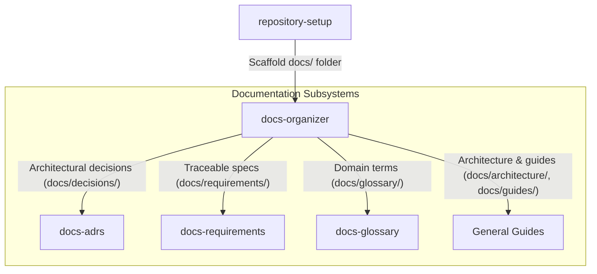

# Docs Organizer Skill

Scaffolds, structures, and organizes comprehensive documentation within a repository's `docs/` folder.

This skill serves as the central documentation architect. When setting up or structuring a project's documentation, `docs-organizer` establishes standard navigation, architectural guides, and manuals, while delegating specialized documentation domains to dedicated, focused skills.

---

## Architectural Delegation Model



> [!NOTE]
> **Independent Invocability**:
> Although `docs-organizer` coordinates the initial layout and structure of `docs/`, the specialized skills ([`docs-adrs`](../docs-adrs/SKILL.md), [`docs-requirements`](../docs-requirements/SKILL.md), and [`docs-glossary`](../docs-glossary/SKILL.md)) remain **completely independent and self-contained**. Any of these skills can be invoked on its own at any time without involving `docs-organizer`.

---

## Standard `docs/` Layout

Refer to [references/documentation-structure.md](./references/documentation-structure.md) for details on each directory's role:

```text
docs/
├── README.md               # Main navigation hub (use assets/docs-readme-template.md)
├── architecture/           # High-level architecture, system context, and component design
├── decisions/              # Architecture Decision Records (delegated to docs-adrs)
├── requirements/           # System requirements & OFT specifications (delegated to docs-requirements)
├── glossary/               # Domain terminology (delegated to docs-glossary)
└── guides/                 # User guides, developer onboarding, operational runbooks
```

---

## Step-by-Step Scaffolding Procedure

### Step 1: Initialize the Documentation Hub

1. Create the base documentation directory:
   ```bash
   mkdir -p docs/architecture docs/guides
   ```
2. Create `docs/README.md` from the template in [assets/docs-readme-template.md](./assets/docs-readme-template.md).
3. Ensure `docs/README.md` serves as a clear entry point linking to architecture, decisions, requirements, glossary, and guides.

---

### Step 2: Delegate Specialized Documentation Subsystems

Delegate each specialized subsystem to its corresponding skill:

1. **Architectural Decisions (`docs/decisions/`)**:
   - Delegate to the **`docs-adrs`** skill.
   - Bootstraps `docs/decisions/` and records initial ADRs (e.g., `0000-use-markdown-architectural-decision-records.md`) using MADR templates.
2. **System Requirements & Specifications (`docs/requirements/`)**:
   - Delegate to the **`docs-requirements`** skill.
   - Bootstraps `docs/requirements/` with traceable OpenFastTrace (OFT) specifications, feature hierarchies (`feat` &rarr; `req`), and tagging rules.
3. **Domain Terminology & Glossary (`docs/glossary/`)**:
   - Delegate to the **`docs-glossary`** skill.
   - Bootstraps `docs/glossary/README.md` and `docs/glossary/TEMPLATE.md` to define project-specific terms upon user request.

---

### Step 3: Scaffold General Guides & Architecture

For projects requiring technical manuals or architecture overviews:

1. **Architecture Overview (`docs/architecture/overview.md`)**:
   - High-level system goals, component diagrams (using Mermaid), technology stack summary, and external integrations.
2. **Developer Onboarding (`docs/guides/getting-started.md`)**:
   - Step-by-step local development setup, prerequisites, running tests, and debugging advice.

---

### Step 4: Markdown Quality & Linting

Enforce consistent documentation formatting across all markdown files:

```bash
npx markdownlint-cli "docs/**/*.md"
```

Advise integrating markdownlint into the project's CI workflow (e.g. `.github/workflows/lint.yml`).

---

## Supporting Assets & References

- **Documentation Structure Reference**: [references/documentation-structure.md](./references/documentation-structure.md)
- **Docs README Template**: [assets/docs-readme-template.md](./assets/docs-readme-template.md)
