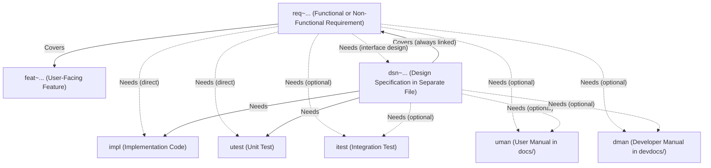

# Docs Requirements (OFT) Skill

Guides the authoring, structuring, and validation of traceable software requirements using [OpenFastTrace (OFT)](https://github.com/itsallcode/openfasttrace).

## Goals of Requirements Tracing

- **Systematize Project Requirements**: Maintain a single, structured source of truth for all software capabilities.
- **Maintain Feature Overview**: Provide a complete, navigable inventory of user-facing features and system constraints.
- **Link Features to Code & Tests**: Create bidirectional links from requirements to implementing code (`impl`) and automated tests (`utest`, `itest`).
- **Enforce Verification Artifacts**: Ensure features are backed by verification artifacts before being considered complete.
- **Direct & Constrain AI Agents**: Keep AI coding agents aligned with exact architectural and behavioral requirements, preventing hallucinated or unauthorized features.

---

## The Human-in-the-Loop Principle

> [!IMPORTANT]
> Because coding agents cannot reliably discern which business rules or features should be formally specified, **requirements must be directed and requested by the programmer (the user)**.
>
> - The **programmer** decides *which* requirements should be created and *where* they belong.
> - The **AI agent** formulates the formal specification items, enforces style rules, and tags the implementation and test code.

---

## Project Structure & Setup

### 1. File Locations & Customization
- Requirements typically live in `devdocs/requirements/` within the developer documentation tree. This directory path can be customized per project if preferred, but the skill advises using `devdocs/requirements/`.
- If the repository has no existing requirements guide, bootstrap `devdocs/requirements/README.md` using [assets/README-template.md](./assets/README-template.md).

### 2. Configure Scoped `.oftignore`
Create a `.oftignore` file at the repository root using [assets/.oftignore.template](./assets/.oftignore.template).
- **Scope strictly to project needs**: Only include ignore rules for directories that are present or might be present in the project (e.g., if the project does not use Node.js, do not include `node_modules/`; if it does not use Python, omit `__pycache__/` and `.venv/`).

---

## Document Heading Hierarchy & Organization

Specifications in `devdocs/requirements/` are divided into **Feature/Requirement specifications** and **Design Specifications (`dsn`)** in separate files:

### 1. Feature & Requirement Documents (e.g. `devdocs/requirements/cli.md`)
- **Document Title (`#`)**: Level 1 heading for the feature domain (e.g. `# CLI Specifications`).
- **Feature (`##`)**: Level 2 heading for each `feat~` capability (e.g. `## User can access the program via CLI`).
- **Requirement (`###`)**: Level 3 heading for each `req~` constraint (e.g. `### System must provide a command-line interface`).
- **Placement Rule**: `req` items are **always located directly within the `##` section** of their covering feature.
- **File Grouping**: Features and requirements are grouped by feature domain across files (e.g. `devdocs/requirements/cli.md`, `devdocs/requirements/chat.md`). Multiple features can reside in a single file—ask the human programmer how they prefer to group them.

### 2. Design Specification Documents (`dsn`) in Separate Files (e.g. `devdocs/requirements/dsn-cli-commands.md`)
- **Separate File Rule**: Detailed interface, standard, or protocol specifications (`dsn`) live in **their own dedicated Markdown file**, decoupled from feature overviews.
- **Document Title & Item (`#`)**: Level 1 heading defines the `dsn` specification item:
  ```markdown
  # CLI Command Structure and Syntax
  `dsn~cli.commands~1`

  Covers: req~cli.command-structure~1

  Needs: impl, utest, uman, dman
  ```
- **Internal Sub-element Hierarchy (`##`, `###`, `####`)**: Subcommands, flags, REST endpoints, schemas, or language grammar constructs are structured inside this file **strictly via deeper Markdown headings**.
- **Flat Graph Invariant**: A `dsn` item **never covers another `dsn`**. Sub-headings do not declare separate `dsn` tags; the requirements trace graph remains clean and flat.

---

## Requirement Hierarchy & Relationships

Requirements follow this standard hierarchy:



1. **`feat` (Feature)**:
   - High-level, user-facing capability describing what the user can do (e.g. *User can access the program via CLI*).
   - Needs: `req`.
2. **`req` (Requirement - Functional or Non-Functional)**:
   - Precise system constraint or behavioral rule complementing the feature.
   - Can be **functional** (e.g. *System must validate API tokens*) or **non-functional** (e.g. *System must respond within 200ms*, *System must run without root privileges*).
   - Covers: `feat` (`Covers: feat~...`).
   - Needs: Can directly need `impl`, `utest`, `itest`, `uman`, `dman`, and when specifying an interface or standard, **needs `dsn`** (`Needs: dsn, impl, utest`).
3. **`dsn` (Design Specification)**:
   - Dedicated design document specifying a concrete standard, protocol, or interface.
   - **Always linked to a requirement**: Every `dsn` must cover a parent requirement (`Covers: req~...`).
   - **Lives in a separate file**: Authored in its own dedicated Markdown file (e.g. `devdocs/requirements/dsn-cli-commands.md`).
   - **Typical Use Cases**:
     - Complete REST API resource and endpoint listings (paths, HTTP methods, payloads).
     - Full CLI command and subcommand trees, arguments, and option flags.
     - Domain-Specific Language (DSL) or programming language grammar, keywords, and AST specs.
     - Formal communication protocols or wire formats.
   - Needs: `impl`, `utest`, and optionally `itest`, `uman`, `dman`.
   - **Levels via Markdown Headings Only**: Subcommands, routes, or parameters are represented **strictly by nesting Markdown headings** (`##`, `###`), **never via `Covers`**. A `dsn` item **never covers another `dsn`**.
4. **Concrete Hierarchy Example**:
   - In `devdocs/requirements/cli.md`:
     - `feat~app.cli~1` (*User can access the program via CLI*)
       `Needs: req`
     - `req~app.cli.interface~1` (*System must provide a command-line interface*)
       `Covers: feat~app.cli~1`
       `Needs: dsn, impl, utest`
   - In `devdocs/requirements/dsn-cli-commands.md`:
     - `dsn~app.cli.commands~1` (*CLI command tree and options specification*)
       `Covers: req~app.cli.interface~1`
       `Needs: impl, utest, uman, dman`

### Requirement Levels & Quality Matrix

| Document Scope | Level | Artifact Type | Meaning & Purpose | Covers | Location |
| :--- | :---: | :--- | :--- | :--- | :--- |
| **System Specifications** | 1 | `feat` | Top-level capability offered to the user (e.g. *User can access CLI*) | *(None)* | `devdocs/requirements/*.md` |
| | 2 | `req` | Functional or non-functional requirement / constraint (e.g. *System must provide CLI*) | `feat` | `devdocs/requirements/*.md` |
| **Design Specifications** | 3 | `dsn` | Concrete interface, protocol, or standard design (e.g. CLI command tree, REST API) | `req` | `devdocs/requirements/dsn-*.md` |
| **Production Code** | 4 | `impl` | Most specific statement or function fulfilling the requirement or design | `req`, `dsn` | `src/` |
| **Test Code** | 4 | `utest` | Automated unit test verifying requirement or design compliance | `req`, `dsn` | `src/` (or `tests/`) |
| | 4 | `itest` | Integration test across subsystem, database, or network boundaries | `req`, `dsn` | `tests/` |
| **User Documentation** | 4 | `uman` | End-user manuals, guides, tutorials, and walkthroughs | `req`, `dsn` | `docs/` |
| **Developer Documentation** | 4 | `dman` | Internal developer guides, architecture manuals, and contributor runbooks | `req`, `dsn` | `devdocs/` |

5. **Forwarding Rules**:
   - `feat` can be forwarded **only to `req`** (or directly to `impl, utest`):
     ```markdown
     feat --> req : feat~ui.theme.dark-mode~1
     ```
   - `req` can be forwarded **only to `dsn`** (or directly to `impl, utest`):
     ```markdown
     req --> dsn : req~api.rest.v1~1
     ```
   - **No `feat` to `dsn` forwarding**: A feature can never skip `req` and forward directly to a `dsn`.

---

## Requirement ID Naming Conventions

Use dot-separated (`.`) hierarchical identifiers to represent levels of requirements:
- `ai.chat`
- `ai.chat.message.delete`
- `ai.chat.message.regenerate`
- `ai.summarization`

Format: `<type>~<dot.separated.name>~<revision>` (e.g. `req~ai.chat.message.delete~1`).

---

## Implementation Tagging Rules (`impl`)

- **The Most Specific Statement Rule**: An `impl` tag must **always point to the most specific code statement or function** that implements the requirement, never to an entire class or file.
- **Comment Pairing**: Place the `[impl -> ...]` tag on its own line above the statement, followed by an explanatory comment on the next line describing how it is fulfilled (never place comments on the same line after the tag):
  ```python
  # [impl -> req~api.client.retry-backoff~1]
  # Calculate exponential backoff with full jitter to avoid thundering herd
  delay = random.uniform(0, min(MAX_DELAY, BASE_DELAY * (2 ** attempt)))
  time.sleep(delay)
  ```

---

## Tagging in Documentation (`uman` and `dman`)

In Markdown documentation files, embed coverage tags inside HTML comments:

### 1. User Documentation (`docs/` -> `uman`)
For end-user manuals, public guides, and tutorials located in `docs/`:
```markdown
<!-- [uman -> req~ai.chat.message.delete~1] -->
To delete a message, click the trash icon next to the message bubble.
```

### 2. Developer Documentation (`devdocs/` -> `dman`)
For developer guides, architectural internals, and maintainer manuals located in `devdocs/`:
```markdown
<!-- [dman -> dsn~cli.command-syntax~1] -->
CLI command routing is implemented via the commands layer in `src/commands/mod.rs`.
```

---

## Requirement Style & Grammar Guidelines

Adhere strictly to these grammar and formulation rules:

### 1. Title Rules
- **Grammar Matching Tag**:
  - `feat~` titles: Must use **"User can [verb]"** (e.g. `User can delete sent messages`).
  - `req~` titles: Must use **"[Subject] must [verb]"** (e.g. `System must display privacy notice on first launch`). Always use **must** (never "should", "needs to", or "is required to").
- **Single Modal Verb**: Use only one modal verb per requirement title.
- **One Item, One Requirement**: Each item must specify exactly one rule. If the title requires "and", split it into two distinct items.
- **Avoid Nominalizations**: Use active verbs (e.g. *"System must verify token"*, not *"Token verification"*).
- **Avoid Narrator Phrasing**: State what must occur directly; avoid *"allows the user to"* or *"offers ability to"*.

### 2. Description Rules
- **No Implementation Details**: Descriptions must specify *what* the system must do, never *how* the code achieves it (e.g. do not specify database tables or internal algorithms).
- **Scope**: Use description only for context the title cannot hold:
  - Triggering condition or prerequisite state.
  - Edge cases, error responses, and boundary values.
  - Tracker reference (`Issue: #42`).
- **Dedicated Rationale**: Do not bury justifications or business context in the description. Use an explicit `Rationale:` keyword.
- **No Marketing Copy**: Keep descriptions technical, concise, and non-promotional.

---

## Draft Status for Future Requirements

For requirements planned for upcoming milestones but not yet implemented:
```markdown
### System must encrypt cached messages on device
`req~ai.chat.cache-encryption~1`

Status: draft

Needs: impl, utest
```
When running validation in CI/CD or release checks, exclude draft items using `-i draft` or `-t _,approved`.

---

## Referencing Requirements in Other Artifacts

- **In ADRs**: A requirement can be referenced in the Context and Problem Statement or Decision Drivers of an Architecture Decision Record if needed (e.g. `Traces to: req~database.persistence~1`).

---

## CI/CD Validation

Advise adding an automated requirements trace check in the project's CI/CD pipeline using the official [OpenFastTrace GitHub Action](https://github.com/itsallcode/openfasttrace-github-action) (`itsallcode/openfasttrace-github-action@v0` with `fail-on-error: true`). See [references/coverage-and-ci.md](./references/coverage-and-ci.md).

---

## Supporting Assets & References

- **Requirements Index Template**: [assets/README-template.md](./assets/README-template.md)
- **Specification Items Template**: [assets/specification-items.template.md](./assets/specification-items.template.md)
- **Design Specification Template**: [assets/design-specification.template.md](./assets/design-specification.template.md)
- **OFT Ignore Template**: [assets/.oftignore.template](./assets/.oftignore.template)
- **Detailed Style & Hierarchy Reference**: [references/style-and-hierarchy.md](./references/style-and-hierarchy.md)
- **Tracing & CI/CD Pipeline Guide**: [references/coverage-and-ci.md](./references/coverage-and-ci.md)
