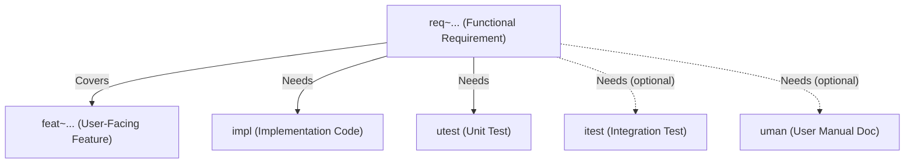

# Requirements & Traceability Guide

This directory contains the formal requirements and specifications for the project, traced using [OpenFastTrace (OFT)](https://github.com/itsallcode/openfasttrace).

Requirements typically live in `docs/requirements/`, but this directory path can be customized per project if preferred.

## Goals of Traceability

1. **Systematize Requirements**: Maintain a clear, structured inventory of all system capabilities.
2. **Feature-to-Code Traceability**: Link user-visible features directly to the code that implements them and the tests that verify them.
3. **Quality Assurance**: Enforce verification artifacts (`impl`, `utest`, `itest`, `uman`) before marking features complete.
4. **Agent Alignment**: Guide AI coding assistants to implement exactly what is specified without drifting or making unwarranted assumptions.

---

## Requirement Hierarchy & Relationships

Requirements follow this standard hierarchy:



- **`feat` (Feature)**: High-level capability offered to the user. Title grammar: *"User can [verb]"*.
- **`req` (Requirement)**: Detailed constraint the system must satisfy to complement the feature. Title grammar: *"Subject must [verb]"*.
- **`impl` (Implementation)**: Specific statement in code implementing the requirement.
- **`utest` (Unit Test)**: Automated unit test asserting requirement compliance.
- **`itest` (Integration Test)**: Integration test (added when integration boundaries are tested).
- **`uman` (User Manual)**: User-facing documentation in Markdown (added when user documentation is required).

> **Forwarding**: If a simple feature does not require decomposition into detailed `req` items, forward coverage directly:
> ```markdown
> feat --> impl, utest : feat~ui.theme.dark-mode~1
> ```

---

## Document Heading Hierarchy & Organization

When organizing requirement documents in `docs/requirements/`:

- **Document Title (`#`)**: Level 1 heading for the document domain (e.g. `# Chat Service Specifications`).
- **Feature (`##`)**: Level 2 heading for each `feat~` capability (e.g. `## User can manage AI chat conversations`).
- **Requirement (`###`)**: Level 3 heading for each `req~` constraint (e.g. `### System must delete message upon user request`).
- **Placement Rule**: `req` items are **always located directly within the `##` section** of their covering feature.
- **File Grouping**: Specifications are typically grouped by feature domains across several files (e.g. `docs/requirements/chat.md`, `docs/requirements/billing.md`). Multiple features can reside in a single file—ask the human programmer how they prefer to group them.

---

## Requirement ID Naming Conventions

Use dot-separated (`.`) hierarchical identifiers to represent levels of requirements:
- `ai.chat`
- `ai.chat.message.delete`
- `ai.chat.message.regenerate`
- `ai.summarization`

Format: `<type>~<dot.separated.name>~<revision>` (e.g. `req~ai.chat.message.delete~1`).

---

## Style Guidelines

### 1. Title Rules
- **Grammar matching tag**:
  - `feat~` items: Use *"User can [verb]"* (e.g. `User can delete sent messages`).
  - `req~` items: Use *"Subject must [verb]"* (e.g. `System must display privacy notice on first launch`). Always use the modal verb **must** (never "should", "needs to", or "is required to").
- **Atomic scope**: One item, one requirement. If the title contains "and", split it into two distinct requirements.
- **No nominalizations**: Use active verbs (e.g. *"System must verify token"*, not *"Token verification"*).
- **No narrator phrasing**: State directly what happens; avoid *"allows the user to"* or *"offers the ability to"*.

### 2. Description Rules
- **No implementation details**: Descriptions must specify *what* the system must do, never *how* the code is written or structured.
- **Description content**: Use description strictly for context the title cannot hold:
  - Triggering conditions.
  - Edge cases and boundary behaviors.
  - GitHub issue links (`Issue: #42`).
- **Rationale**: If explaining the justification for a requirement, use an explicit `Rationale:` keyword instead of mixing it into the description.

---

## Tag Syntax in Code, Tests & Documentation

### Code Statements (`impl`)
The `impl` tag must point to the **most specific statement** implementing the requirement. Place the tag on its own line above the statement, followed by an explanatory comment on the next line:

```python
# [impl -> req~api.client.retry-backoff~1]
# Calculate exponential backoff with full jitter to avoid thundering herd
delay = random.uniform(0, min(max_delay, base_delay * (2 ** attempt)))
time.sleep(delay)
```

### Unit Tests (`utest`)
```python
# [utest -> req~api.client.retry-backoff~1]
def test_retry_delay_respects_exponential_backoff_and_jitter():
    ...
```

### Markdown Documentation (`uman`)
In Markdown documentation, embed the coverage tag inside an HTML comment:

```markdown
<!-- [uman -> req~ai.chat.message.delete~1] -->
To delete a message, click the trash icon next to the message bubble.
```

---

## Unimplemented Requirements & Draft Status

For planned or in-progress requirements not yet implemented, set:

```markdown
Status: draft
```

When validating completed features in CI/CD, exclude draft items:

```bash
oft trace -i draft docs/ src/ tests/
```
