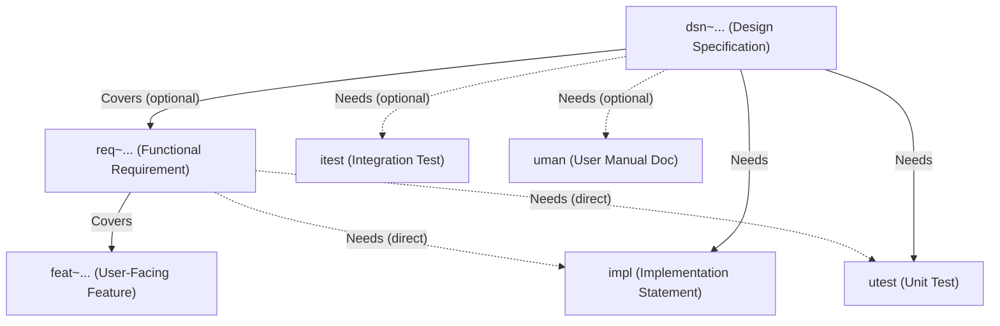

# OpenFastTrace Requirement Style & Hierarchy Reference

A comprehensive guide to authoring high-precision, traceable requirements and specifications.

---

## 1. Requirement Hierarchy & Artifact Types

OpenFastTrace dynamically tracks coverage between specification items and code artifacts.



### Artifact Type Roles

- **`feat` (Feature)**:
  - Represents a broad, user-facing capability of the software.
  - Captures what the user is enabled to do.
- **`req` (Requirement)**:
  - Represents a precise functional constraint or rule the system must satisfy.
  - Complements and breaks down a parent `feat`.
  - Can directly need `impl`, `utest`, or specify interface design by needing `dsn`.
- **`dsn` (Design Specification)**:
  - Design document specifying a standard, interface, protocol, or syntax structure.
  - Examples: REST API endpoints and payloads, CLI command trees and flags, language grammar and AST rules.
  - Covers a parent `req` (`Covers: req~...`).
  - Needs `impl`, `utest`, and optionally `itest`, `uman`.
  - **Flat in Graph, Nested in Markdown**: Subcommands, sub-routes, and parameter details are represented **only by deeper Markdown headings** (`#####`, `######`). A `dsn` item **never covers another `dsn`**.
- **`impl` (Implementation)**:
  - Source code marker. Must be placed at the **most specific location** in code (see [Implementation Tagging Rules](#5-implementation-tagging-rules-impl)).
- **`utest` (Unit Test)**:
  - Unit test function or method asserting compliance with the requirement or design specification.
- **`itest` (Integration Test)**:
  - Added only when the requirement spans external services, database queries, network boundaries, or multi-module pipelines.
- **`uman` (User Manual)**:
  - Added only when the feature requires dedicated documentation in the user manual or public guide.

---

## 2. Document Heading Structure & Organization

When drafting requirements files in `docs/requirements/`:

- **Document Title (`#`)**: Level 1 heading for the document domain (e.g. `# CLI Interface Specifications`).
- **Feature (`##`)**: Level 2 heading for each `feat~` capability (e.g. `## User can access the program via CLI`).
- **Requirement (`###`)**: Level 3 heading for each `req~` constraint (e.g. `### System must provide a command-line interface`).
- **Design Specification (`####`)**: Level 4 heading for interface or standard definitions (e.g. `#### CLI Command Tree and Options`).
- **Design Sub-elements (`#####`, `######`)**: Subcommands, options, and parameters nested purely via deeper Markdown headings without separate covering tags.
- **Placement Rule**: `req` items are **always located directly within the `##` section** of their covering feature. `dsn` items are **located directly within the `###` section** of their covering requirement.
- **File Grouping**: Specifications are typically grouped by feature domains across several files (e.g. `docs/requirements/cli.md`, `docs/requirements/chat.md`). Multiple features can reside in a single file—ask the human programmer how they prefer to group them.

---

## 3. Requirement ID Naming Conventions

Use dot-separated (`.`) hierarchical identifiers to represent levels of requirements:
- `ai.chat`
- `ai.chat.message.delete`
- `ai.chat.message.regenerate`
- `ai.summarization`

Format: `<type>~<dot.separated.name>~<revision>` (e.g. `req~ai.chat.message.delete~1`).

---

## 4. Requirement Style & Grammar Rules

### Title Grammar
- **Grammar matches artifact tag**:
  - `feat~` titles must use: **"User can [verb] [object]"**
    - *Good*: `User can reset password via email`
    - *Bad*: `Password reset function`
  - `req~` titles must use: **"[Subject] must [verb] [object]"**
    - *Good*: `System must send password reset link with 15-minute expiration`
    - *Bad*: `System should send password reset link`
- **Strictly use "must"**: For `req~`, always use the modal verb **must**. Never use "should", "needs to", "is required to", or "may".
- **One Item, One Requirement**:
  - Each item must contain exactly one normative statement.
  - If the title requires "and" to express two actions, split it into two separate requirements.
- **Avoid Nominalizations**: Use active verbs.
  - *Good*: `System must validate session token`
  - *Bad*: `System token validation`
- **Avoid System-as-Narrator Phrasing**:
  - *Bad*: `System allows the user to delete records`
  - *Good*: `User can delete records` (as `feat~`) or `System must delete record upon user confirmation` (as `req~`).

### Description Content
- **No Implementation Details**:
  - Requirements state **what** the system must accomplish, never **how** it is implemented in code.
  - *Bad*: *"Use Redis hash with TTL 300 to store temporary keys."*
  - *Good*: *"The temporary token expires automatically after 5 minutes."*
- **What belongs in description**:
  - The triggering condition (e.g. *"When the network connection drops..."*).
  - Edge cases, error responses, and boundary values.
  - Linked GitHub issues or tickets (`Issue: #123`).
- **Rationale Section**:
  - If explaining business reasoning, regulatory justification, or architectural motives, do not bury it in the description. Use an explicit `Rationale:` keyword.

---

## 5. Implementation Tagging Rules (`impl`)

Traceability tags link specifications directly to the codebase.

### The "Most Specific Statement" Rule
An `impl` marker must never be slapped generically onto a whole file or class declaration. It must point to the **most specific statement or function** that executes the requirement:

```python
def execute_request_with_retry(client: HttpClient, request: HttpRequest) -> HttpResponse:
    for attempt in range(MAX_RETRIES):
        try:
            return client.send(request)
        except NetworkError:
            if attempt == MAX_RETRIES - 1:
                raise

            # [impl -> req~api.client.retry-backoff~1]
            # Calculate exponential backoff with full jitter to avoid thundering herd
            delay = random.uniform(0, min(MAX_DELAY, BASE_DELAY * (2 ** attempt)))
            time.sleep(delay)
```

> **Rules**:
> - Never put comments on the same line after the `[impl -> ...]` tag.
> - If an exact single line cannot isolate the full implementation, place the `[impl -> ...]` tag directly above the statement/block, followed immediately by an explanatory comment on the next line clarifying how the requirement is fulfilled.

---

## 6. Forwarding Rules

When intermediate specification items are skipped, forwarding allows linking items directly while respecting strict architectural boundaries:

1. **`feat` Forwarding**:
   - A `feat` can be forwarded **only to `req`** (or directly to `impl, utest`):
     ```markdown
     feat --> req : feat~ui.navigation~1
     ```
     ```markdown
     feat --> impl, utest : feat~ui.sidebar.toggle~1
     ```
2. **`req` Forwarding**:
   - A `req` can be forwarded **only to `dsn`** (or directly to `impl, utest`):
     ```markdown
     req --> dsn : req~api.rest.v1~1
     ```
3. **Prohibited Forwarding**:
   - **No `feat` to `dsn` forwarding**: A feature can never skip `req` and forward directly to a `dsn`. Every design specification must trace through a requirement.
   - **No `dsn` to `dsn` forwarding**: Design specifications do not cover or forward to other design specifications.

---

## 7. Tagging in Markdown Files (`uman`)

In Markdown documentation, embed the coverage tag inside an HTML comment:

```markdown
<!-- [uman -> req~ai.chat.message.delete~1] -->
To delete a message, click the trash icon next to the message bubble.
```
