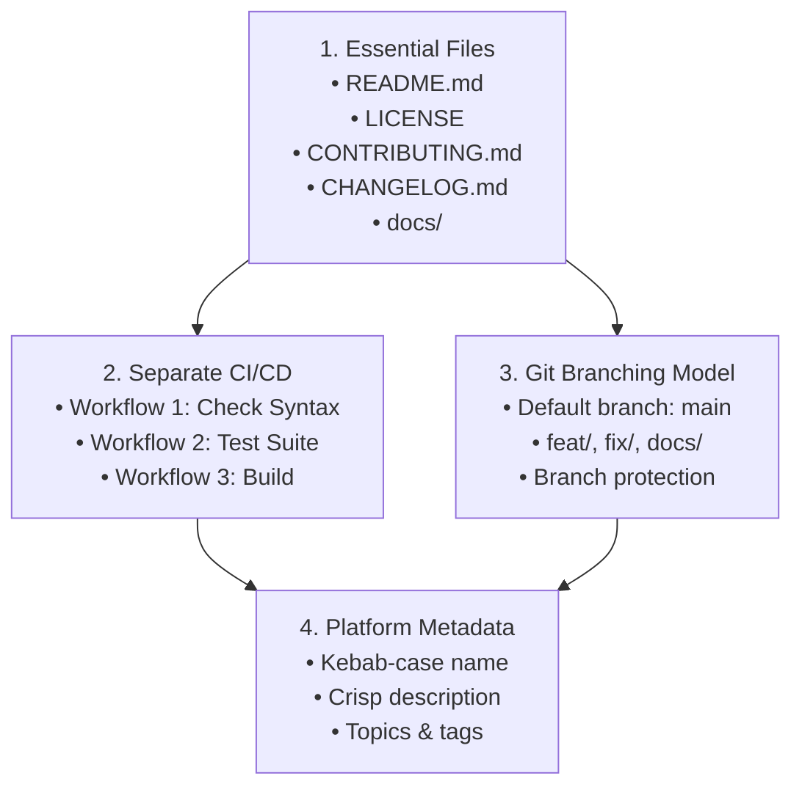

# Repository Setup Skill

Guides the bootstrapping, configuration, and standardization of software repositories across any programming language or framework.

## When to Use This Skill

Activate this skill when:
- Initializing a brand-new repository from scratch.
- Auditing or standardizing an existing repository to meet professional software engineering practices.
- Setting up baseline files (`README.md`, `LICENSE`, `CONTRIBUTING.md`, `CHANGELOG.md`, documentation directory).
- Designing separate CI/CD workflows (syntax check, automated tests, build verification).
- Configuring Git branching strategies or GitHub/GitLab repository metadata.

---

## Core Repository Setup Checklist

A complete, production-ready repository requires four foundational pillars:



---

## Step-by-Step Setup Workflow

### Step 1: Scaffold Core Repository Files

1. **`README.md`**:
   - Every project must have a clear `README.md` providing project mission, prerequisites, installation, usage, testing commands, and license details.
   - Use the template in [assets/README-template.md](./assets/README-template.md).
2. **`LICENSE`**:
   - Choose an appropriate license (e.g. permissive `MIT` or `Apache-2.0` for open-source; custom proprietary license for private commercial code).
   - Ensure the copyright holder and year are accurate.
3. **`CONTRIBUTING.md`**:
   - Guide prospective contributors on branching, local environment setup, local verification commands, and PR submission rules.
   - Use the template in [assets/CONTRIBUTING-template.md](./assets/CONTRIBUTING-template.md).
4. **`CHANGELOG.md` & Semantic Versioning (SemVer)**:
   - Maintain a human-readable record of changes adhering to the [Keep a Changelog](https://keepachangelog.com/) standard.
   - Strictly follow [Semantic Versioning (SemVer)](https://semver.org/) (`MAJOR.MINOR.PATCH`):
     - `MAJOR`: Incompatible API or breaking changes.
     - `MINOR`: Backwards-compatible new features.
     - `PATCH`: Backwards-compatible bug fixes.
   - Categorize entries under standard release headers: `Added`, `Changed`, `Deprecated`, `Removed`, `Fixed`, `Security`.
   - Use the template in [assets/CHANGELOG-template.md](./assets/CHANGELOG-template.md).
5. **`docs/` Structure**:
   - Create a dedicated `docs/` folder for system architecture, specifications, and user manuals.
   - Create `docs/decisions/` and bootstrap ADR-0000 using the `adr-writer` skill to document architectural choices.
   - For formal requirements, maintain traceable specifications using the `requirements` skill.

---

### Step 2: Establish Separate CI/CD Workflows

Configure separate, independent workflows that execute on pull requests and pushes to `main`. Refer to [references/cicd-workflows.md](./references/cicd-workflows.md) for workflow configurations.

1. **Workflow 1: Check Syntax (Fail Fast)**:
   - Run code linters, formatters, static analyzers, and type-checkers (e.g. ESLint, Ruff, cargo clippy, tsc).
   - Run `markdownlint` across all Markdown documentation (`README.md`, `docs/**/*.md`).
2. **Workflow 2: Automated Tests**:
   - Execute unit and integration tests.
   - Ensure tests run in an isolated environment and fail on regression.
3. **Workflow 3: Build & Package Verification**:
   - Compile or bundle release artifacts to guarantee build reproducibility.

---

### Step 3: Configure Git Branching Strategy & Protection

Refer to [references/metadata-and-branches.md](./references/metadata-and-branches.md) for branch management standards.

1. **Default Branch**: Use `main` as the default, production-ready branch.
2. **Branch Naming Conventions**:
   - `feat/<feature-name>`: New capabilities or features.
   - `fix/<issue-description>`: Bug fixes and patches.
   - `docs/<topic>`: Documentation, ADRs, or specification updates.
   - `chore/<task>`: Tooling, dependencies, or CI updates.
3. **Branch Protection**:
   - Disallow direct pushes to `main`.
   - Require pull requests with passing CI checks (syntax, test, build) prior to merge.

---

### Step 4: Configure GitHub / GitLab Repository Metadata

Populate repository metadata to ensure discoverability and clarity:

1. **Repository Name**: Lowercase, kebab-case (e.g. `user-auth-service`).
2. **Description**: Concise one-sentence summary (< 160 characters) explaining what the project does.
3. **Topics / Tags**: Add 5–10 relevant tags covering runtime, language, domain, and tooling (e.g. `python`, `fastapi`, `cli`, `ai-agents`).
4. **CLI Quick Command (GitHub)**:
   ```bash
   gh repo edit --description "Short crisp summary" --add-topic "ai-agents" --add-topic "developer-tools"
   ```

---

### Step 5: Markdown Style & Verification

Since documentation files (`README.md`, `CONTRIBUTING.md`, `docs/**/*.md`) are written in Markdown, run `markdownlint` to ensure proper heading hierarchies, clean formatting, and valid lists:

```bash
npx markdownlint-cli "**/*.md" --ignore node_modules
```

---

## Supporting Assets & References

- **README Template**: [assets/README-template.md](./assets/README-template.md)
- **Contributing Guidelines Template**: [assets/CONTRIBUTING-template.md](./assets/CONTRIBUTING-template.md)
- **Changelog Template**: [assets/CHANGELOG-template.md](./assets/CHANGELOG-template.md)
- **CI/CD Workflows Guide**: [references/cicd-workflows.md](./references/cicd-workflows.md)
- **Metadata & Branching Reference**: [references/metadata-and-branches.md](./references/metadata-and-branches.md)
