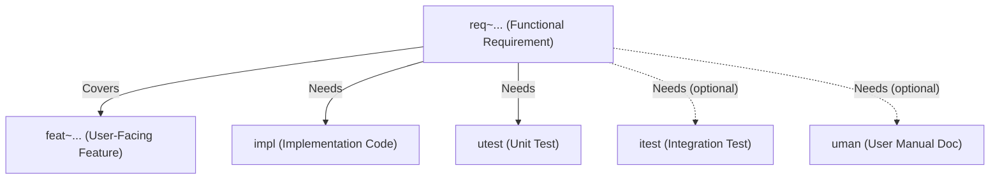

# OpenFastTrace (OFT) Requirements Skill

Guides the authoring, structuring, and validation of traceable software requirements using [OpenFastTrace (OFT)](https://github.com/itsallcode/openfasttrace).

## Goals of Requirements Tracing

- **Systematize Project Requirements**: Maintain a single, structured source of truth for all software capabilities.
- **Maintain Feature Overview**: Provide a complete, navigable inventory of user-facing features and system constraints.
- **Link Features to Code & Tests**: Create bidirectional links from requirements to implementing code (`impl`) and automated tests (`utest`, `itest`).
- **Enforce Verification Artifacts**: Ensure features are backed by verification artifacts before being considered complete.
- **Direct & Constrain AI Agents**: Keep AI coding agents aligned with exact architectural and behavioral requirements, preventing hallucinated or unauthorized features.

---

## The Human-in-the-Loop Principle

> [!IMPORTANT]
> Because coding agents cannot reliably discern which business rules or features should be formally specified, **requirements must be directed and requested by the programmer (the user)**.
>
> - The **programmer** decides *which* requirements should be created and *where* they belong.
> - The **AI agent** formulates the formal specification items, enforces style rules, and tags the implementation and test code.

---

## Project Structure & Setup

### 1. File Locations & Customization
- Requirements typically live in `docs/requirements/`. This directory path can be customized per project if preferred, but the skill advises using `docs/requirements/`.
- If the repository has no existing requirements guide, bootstrap `docs/requirements/README.md` using [assets/README-template.md](./assets/README-template.md).

### 2. Configure Scoped `.oftignore`
Create a `.oftignore` file at the repository root using [assets/.oftignore.template](./assets/.oftignore.template).
- **Scope strictly to project needs**: Only include ignore rules for directories that are present or might be present in the project (e.g., if the project does not use Node.js, do not include `node_modules/`; if it does not use Python, omit `__pycache__/` and `.venv/`).

---

## Document Heading Hierarchy & Organization

When drafting requirements documents in `docs/requirements/`:

- **Document Title (`#`)**: Level 1 heading for the document domain (e.g. `# Chat Service Specifications`).
- **Feature (`##`)**: Level 2 heading for each `feat~` capability (e.g. `## User can manage AI chat conversations`).
- **Requirement (`###`)**: Level 3 heading for each `req~` constraint (e.g. `### System must delete message upon user request`).
- **Placement Rule**: `req` items are **always located directly within the `##` section** of their covering feature.
- **File Grouping**: Specifications are typically grouped by feature domains across several files (e.g. `docs/requirements/chat.md`, `docs/requirements/billing.md`). Multiple features can reside in a single file—ask the human programmer how they prefer to group them.

---

## Requirement Hierarchy & Relationships

Requirements follow this standard hierarchy:



1. **`feat` (Feature)**: Unrefined, user-facing capability. Describes what the user can do (e.g. *AI Chat*).
2. **`req` (Requirement)**: Detailed constraint or specification complementing the feature. It covers the feature (`Covers: feat~...`).
3. **Needs of the Requirement**:
   - `impl` and `utest` are commonly needed for nearly every functional requirement.
   - `itest` is added only when testing cross-service or database boundaries.
   - `uman` is added only when user-facing documentation is required.
4. **Forwarding**: If a simple feature does not warrant decomposition into detailed `req` items, forward coverage directly:
   ```markdown
   feat --> impl, utest : feat~ui.theme.dark-mode~1
   ```

---

## Requirement ID Naming Conventions

Use dot-separated (`.`) hierarchical identifiers to represent levels of requirements:
- `ai.chat`
- `ai.chat.message.delete`
- `ai.chat.message.regenerate`
- `ai.summarization`

Format: `<type>~<dot.separated.name>~<revision>` (e.g. `req~ai.chat.message.delete~1`).

---

## Implementation Tagging Rules (`impl`)

- **The Most Specific Statement Rule**: An `impl` tag must **always point to the most specific code statement or function** that implements the requirement, never to an entire class or file.
- **Comment Pairing**: Place the `[impl -> ...]` tag on its own line above the statement, followed by an explanatory comment on the next line describing how it is fulfilled (never place comments on the same line after the tag):
  ```python
  # [impl -> req~api.client.retry-backoff~1]
  # Calculate exponential backoff with full jitter to avoid thundering herd
  delay = random.uniform(0, min(MAX_DELAY, BASE_DELAY * (2 ** attempt)))
  time.sleep(delay)
  ```

---

## Tagging in Documentation (`uman`)

In Markdown documentation files, embed the coverage tag inside an HTML comment:

```markdown
<!-- [uman -> req~ai.chat.message.delete~1] -->
To delete a message, click the trash icon next to the message bubble.
```

---

## Requirement Style & Grammar Guidelines

Adhere strictly to these grammar and formulation rules:

### 1. Title Rules
- **Grammar Matching Tag**:
  - `feat~` titles: Must use **"User can [verb]"** (e.g. `User can delete sent messages`).
  - `req~` titles: Must use **"[Subject] must [verb]"** (e.g. `System must display privacy notice on first launch`). Always use **must** (never "should", "needs to", or "is required to").
- **Single Modal Verb**: Use only one modal verb per requirement title.
- **One Item, One Requirement**: Each item must specify exactly one rule. If the title requires "and", split it into two distinct items.
- **Avoid Nominalizations**: Use active verbs (e.g. *"System must verify token"*, not *"Token verification"*).
- **Avoid Narrator Phrasing**: State what must occur directly; avoid *"allows the user to"* or *"offers ability to"*.

### 2. Description Rules
- **No Implementation Details**: Descriptions must specify *what* the system must do, never *how* the code achieves it (e.g. do not specify database tables or internal algorithms).
- **Scope**: Use description only for context the title cannot hold:
  - Triggering condition or prerequisite state.
  - Edge cases, error responses, and boundary values.
  - Tracker reference (`Issue: #42`).
- **Dedicated Rationale**: Do not bury justifications or business context in the description. Use an explicit `Rationale:` keyword.
- **No Marketing Copy**: Keep descriptions technical, concise, and non-promotional.

---

## Draft Status for Future Requirements

For requirements planned for upcoming milestones but not yet implemented:
```markdown
### System must encrypt cached messages on device
`req~ai.chat.cache-encryption~1`

Status: draft

Needs: impl, utest
```
When running validation in CI/CD or release checks, exclude draft items using `-i draft` or `-t _,approved`.

---

## Referencing Requirements in Other Artifacts

- **In ADRs**: A requirement can be referenced in the Context and Problem Statement or Decision Drivers of an Architecture Decision Record if needed (e.g. `Traces to: req~database.persistence~1`).

---

## CI/CD Validation

Advise adding an automated requirements trace check in the project's CI/CD pipeline using the official [OpenFastTrace GitHub Action](https://github.com/itsallcode/openfasttrace-github-action) (`itsallcode/openfasttrace-github-action@v0` with `fail-on-error: true`). See [references/coverage-and-ci.md](./references/coverage-and-ci.md).

---

## Supporting Assets & References

- **Requirements Index Template**: [assets/README-template.md](./assets/README-template.md)
- **Specification Items Template**: [assets/specification-items.template.md](./assets/specification-items.template.md)
- **OFT Ignore Template**: [assets/.oftignore.template](./assets/.oftignore.template)
- **Detailed Style & Hierarchy Reference**: [references/style-and-hierarchy.md](./references/style-and-hierarchy.md)
- **Tracing & CI/CD Pipeline Guide**: [references/coverage-and-ci.md](./references/coverage-and-ci.md)
