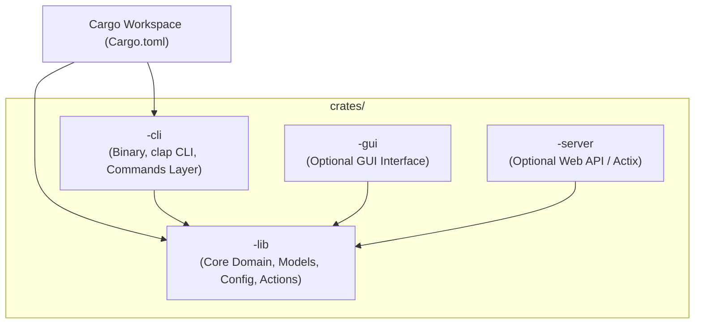
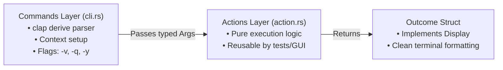

# Rust Development Skill

Guides the architecture, implementation, and maintenance of robust, production-ready Rust projects. Enforces type-driven design, layered module separation, strong error hierarchies, and memory-safe practices.

---

## Core Engineering Principles

1. **Async by Default**: Prefer asynchronous, non-blocking execution using `tokio` for I/O-bound tasks, network calls, and CLI workflows.
2. **Type-Driven Development (TDD)**: Make illegal states unrepresentable at compile time. Model domain rules, validation constraints, and identifiers strictly into Rust's type system.
3. **Structured Errors with `thiserror` (No `anyhow`)**: Avoid unstructured dynamic error boxing in production crates. Define explicit, strongly typed error enums per subsystem and compose them hierarchically.
4. **No Unsafe Code**: Prohibit unsafe blocks (`#![forbid(unsafe_code)]`) unless interfacing with low-level C FFI or performance-critical intrinsics justified by an ADR.
5. **Clear Documentation**: Document all public data structures, traits, and functions using Markdown doc comments (`///` and `//!`).
6. **Explicit Module Files (`mod.rs`)**: Structure module folders with explicit `mod.rs` files (e.g. `src/commands/mod.rs`) for predictable discovery and clear exports.

---

## Workspace & Package Architecture

Structure all multi-component projects as Cargo workspaces. Isolate core business logic from interface-specific binary crates.



### Naming & Packaging Rules
- Use workspace inheritance for dependencies and metadata via [assets/workspace-Cargo.toml](./assets/workspace-Cargo.toml).
- Package naming convention: `<project-slug>-<package-purpose>` (e.g. `auth-lib`, `auth-cli`).
- The library crate (`<project-slug>-lib`) contains business models, services, configuration, and actions. It can be published or reused across binaries (`cli`, `gui`, `web`).

---

## Layered CLI Architecture

CLI applications built with `clap` (derive API) must decouple command-line argument parsing from pure action execution:



Refer to [references/cli-architecture.md](./references/cli-architecture.md) for complete implementations:
1. **Commands Layer (`cli.rs`)**: Parses CLI flags (`--verbose`, `--quiet`, `--yes`), routes subcommands, and handles process exit codes.
2. **Actions Layer (`actions/*.rs`)**: Pure asynchronous execution taking typed `Args` and returning `Result<Outcome, Error>`.
3. **Outcome Formatting**: The `Outcome` struct implements `std::fmt::Display` to handle console presentation cleanly without polluting business logic.

---

## Type-Driven Development Guidelines

Refer to [references/type-driven-design.md](./references/type-driven-design.md) for patterns and examples.

### 1. Newtype Entity Identifiers
Never use bare `Uuid`, `u64`, or `String` for entity IDs. Wrap them in dedicated newtypes using `derive_more` to prevent accidental ID swapping:
```rust
#[derive(Debug, Clone, Copy, PartialEq, Eq, Hash, derive_more::Display, derive_more::From)]
pub struct UserId(uuid::Uuid);
```

### 2. Specific Domain Types
- **IP Addresses**: Use `std::net::IpAddr`.
- **URLs**: Use `url::Url`.
- **Paths**: Use `std::path::PathBuf` / `&Path`.
- **Bounded / Non-Zero Values**: Use `std::num::NonZeroU32`, `std::num::NonZeroUsize`.
- **Non-Empty Strings**: Use `non_empty_string::NonEmptyString`.

### 3. Strict Secrets Management
Never store secrets in raw `String`. Use `secrecy::SecretString` to prevent accidental credential leakage in log statements, error traces, and memory dumps:
```rust
use secrecy::{SecretString, ExposeSecret};
```

---

## Configuration & Logging

### Configuration (`config` crate)
Maintain layered configuration in `<project-slug>-lib` using [assets/config.rs](./assets/config.rs):
1. **Base Configuration File**: YAML format (`config/default.yaml`).
2. **Environment Variables**: Prefixed by project name (e.g. `APP__SERVER__PORT=8080`).
3. **Precedence**: Environment variables strictly override configuration file values.

### Logging
- Use `log` as the universal facade across all library code (`log::debug!`, `log::info!`, `log::warn!`).
- Initialize `env_logger` (or structured loggers) exclusively in executable binary crates (`main.rs`).

---

## Web Backend Architecture (When Applicable)

For web APIs, maintain clean 4-tier separation:
1. **API / Handlers**: HTTP transport, routing, and DTO parsing. Default framework is **Actix-web** (or Axum based on project ADR).
2. **Service**: Core business logic and orchestration.
3. **Repository**: Data access layer and database persistence.
4. **Model**: Pure domain entities and value objects.

> [!IMPORTANT]
> **ORMs, Migrations & Template Engines**:
> Do not select database ORMs (e.g. Diesel, SQLx, SeaORM) or template engines (e.g. Askama, Tera) arbitrarily. Ask the user for specific functional requirements and record the choice in an **Architecture Decision Record (ADR)** via the `docs-adrs` skill.

---

## Testing & Quality Gates

### Testing Strategy
- **Unit Tests**: Co-located in the same source file under `#[cfg(test)] mod tests { ... }`. Test public module contracts.
- **Integration Tests**: Placed in `tests/` at crate root. Test external public API surface end-to-end.
- **Pattern**: Arrange &rarr; Act &rarr; Assert (setup context, invoke action, assert outcome and side effects).

### CI/CD Quality Checks
Refer to [references/cicd-cargo.md](./references/cicd-cargo.md) for GitHub Actions templates:
- `cargo fmt --all -- --check` (Format compliance)
- `cargo clippy --all-targets --all-features -- -D warnings` (Strict linting)
- `cargo test --all-targets --all-features --workspace` (Automated tests)
- `cargo deny check` (Dependency licenses, bans, and security advisories)
- `cargo machete` (Unused dependencies check)

---

## Supporting References & Assets

- **CLI Layered Architecture Guide**: [references/cli-architecture.md](./references/cli-architecture.md)
- **Type-Driven Development Guide**: [references/type-driven-design.md](./references/type-driven-design.md)
- **CI/CD Cargo Workflows**: [references/cicd-cargo.md](./references/cicd-cargo.md)
- **Workspace Cargo.toml Template**: [assets/workspace-Cargo.toml](./assets/workspace-Cargo.toml)
- **Layered Config Template**: [assets/config.rs](./assets/config.rs)
