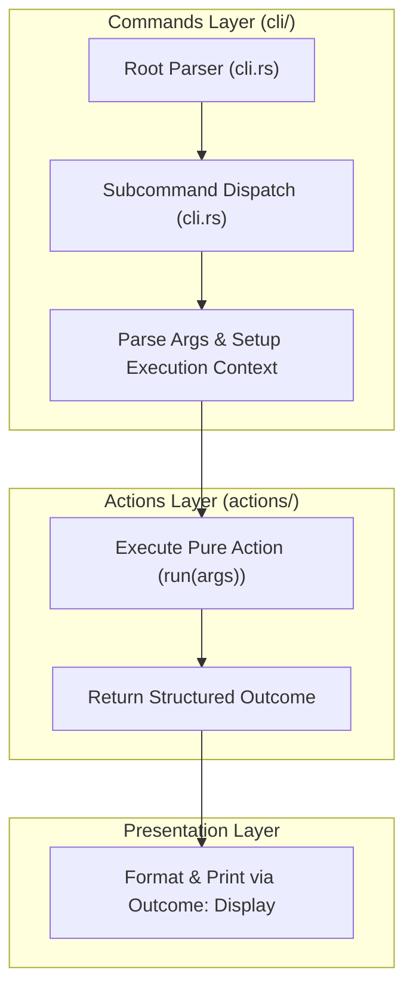

# Layered CLI Architecture Guide

This guide details the standard, decoupled CLI architecture recommended for Rust applications using `clap` (derive API) and `thiserror`.

---

## Architectural Pattern

To keep CLI argument parsing separate from core business execution, applications are structured into two distinct layers:



---

## 1. Commands Layer (`cli/`)

The Commands Layer is responsible for defining CLI arguments, flags, subcommands, and dispatching execution. It transforms raw CLI inputs into typed `Args` structures needed by the actions layer.

### Root Command (`cli/mod.rs` or `cli.rs`)

```rust
//! Root command line structure and router.

use clap::{Parser, Subcommand};
use crate::commands::{database, user};

#[derive(Debug, Parser)]
#[command(name = "my-tool", author, version, about = "My professional CLI tool")]
pub struct Cli {
    /// Enable verbose logging
    #[arg(short, long, global = true)]
    pub verbose: bool,

    /// Suppress non-essential output
    #[arg(short, long, global = true)]
    pub quiet: bool,

    /// Assume 'yes' to all prompts (non-interactive mode)
    #[arg(short = 'y', long, global = true)]
    pub yes: bool,

    #[command(subcommand)]
    pub command: Command,
}

#[derive(Debug, Subcommand)]
pub enum Command {
    /// Manage user resources
    #[command(subcommand)]
    User(user::cli::Command),

    /// Database operations
    #[command(subcommand)]
    Database(database::cli::Command),
}

#[derive(Debug, thiserror::Error)]
pub enum Error {
    #[error("User command failed")]
    User(#[from] user::cli::Error),

    #[error("Database command failed")]
    Database(#[from] database::cli::Error),
}

pub type Result<T> = std::result::Result<T, Error>;

pub async fn run(command: Command) -> Result<()> {
    match command {
        Command::User(cmd) => user::cli::run(cmd).await?,
        Command::Database(cmd) => database::cli::run(cmd).await?,
    }
    Ok(())
}
```

### Subcommand Definition (`commands/user/cli.rs`)

```rust
//! Subcommands for user domain.

use clap::Subcommand;
use crate::actions::user::{create, delete};

#[derive(Debug, Subcommand)]
pub enum Command {
    /// Create a new user
    Create(create::Args),
    /// Delete an existing user
    Delete(delete::Args),
}

#[derive(Debug, thiserror::Error)]
pub enum Error {
    #[error("Failed to create user: {0}")]
    Create(#[from] create::Error),

    #[error("Failed to delete user: {0}")]
    Delete(#[from] delete::Error),
}

pub type Result<T> = std::result::Result<T, Error>;

pub async fn run(command: Command) -> Result<()> {
    match command {
        Command::Create(args) => {
            let outcome = create::run(args).await?;
            println!("{outcome}");
        }
        Command::Delete(args) => {
            let outcome = delete::run(args).await?;
            println!("{outcome}");
        }
    }
    Ok(())
}
```

---

## 2. Actions Layer (`actions/`)

Actions perform the actual work (e.g., file transformations, API calls, process execution). An action:
1. Has **no dependency on `clap`** or command-line specifics.
2. Accepts strongly typed arguments (`Args`).
3. Returns a structured `Outcome` and a domain-specific `Error`.

### Action Implementation (`actions/user/create.rs`)

```rust
//! Action: Create user.

use std::fmt;
use non_empty_string::NonEmptyString;
use secrecy::SecretString;
use crate::models::UserId;

/// Strongly typed arguments required by this action.
#[derive(Debug)]
pub struct Args {
    pub username: NonEmptyString,
    pub password: SecretString,
}

/// Structured outcome returned by the action.
#[derive(Debug)]
pub struct Outcome {
    pub user_id: UserId,
    pub username: NonEmptyString,
}

/// The Outcome implements `Display` for standard terminal presentation.
impl fmt::Display for Outcome {
    fn fmt(&self, f: &mut fmt::Formatter<'_>) -> fmt::Result {
        write!(
            f,
            "Successfully created user '{}' (ID: {})",
            self.username, self.user_id
        )
    }
}

#[derive(Debug, thiserror::Error)]
pub enum Error {
    #[error("User '{0}' already exists")]
    UserAlreadyExists(NonEmptyString),

    #[error("I/O error during user creation: {0}")]
    Io(#[from] std::io::Error),
}

pub type Result<T> = std::result::Result<T, Error>;

/// Executes the user creation action asynchronously.
pub async fn run(args: Args) -> Result<Outcome> {
    // Perform business logic...
    let user_id = UserId::new();

    Ok(Outcome {
        user_id,
        username: args.username,
    })
}
```

---

## Key Benefits of This Separation

1. **Reusability**: Actions can be invoked directly from tests, a GUI crate, or a library API without instantiating CLI commands.
2. **Testability**: Actions take pure Rust data structures and can be tested cleanly without parsing string flags.
3. **Pluggable Output**: Different consumers can inspect the `Outcome` struct fields directly or rely on `Display` for formatted CLI output.
